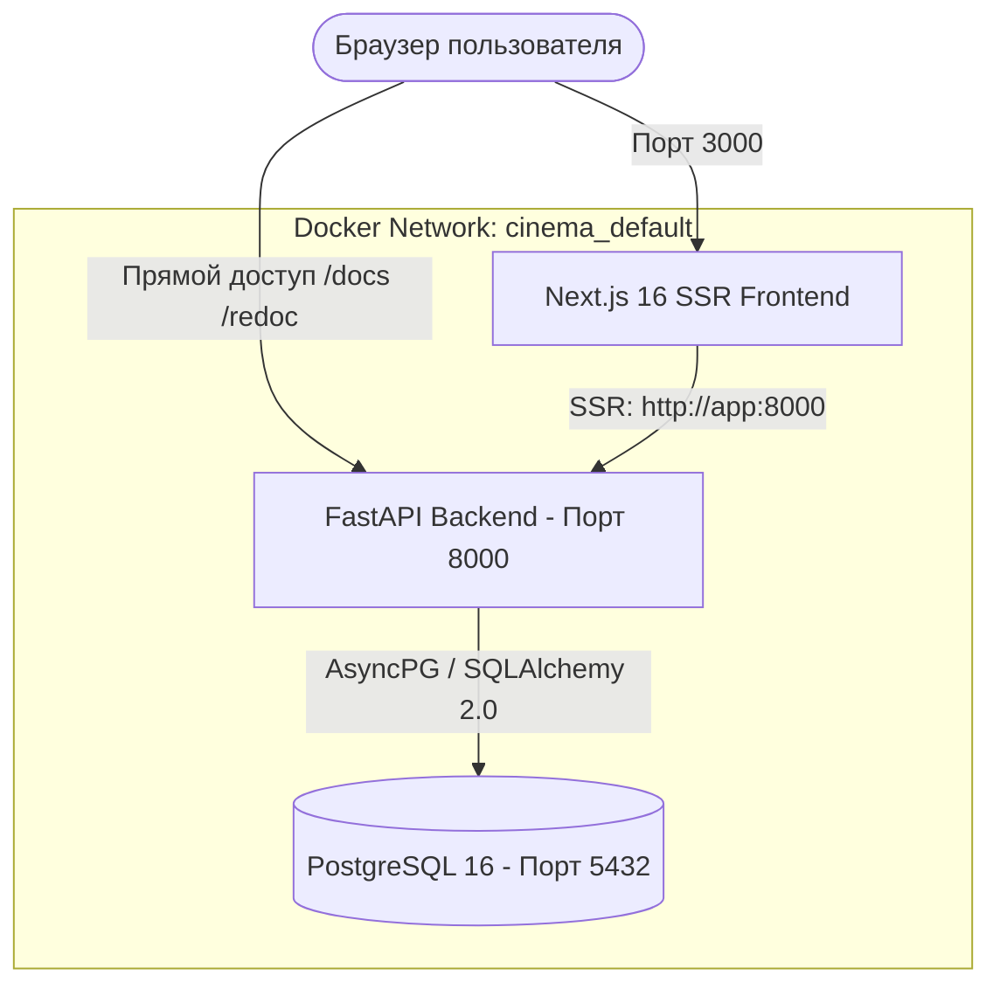

# 🎬 Cinema (CineVault) — Каталог Фильмов

<p align="center">
  
  
  
  
  
  
  
  
</p>

Полнофункциональное веб-приложение для управления и просмотра каталога фильмов по жанрам и категориям. Проект построен на современной асинхронной архитектуре **FastAPI + Next.js + PostgreSQL** и полностью упакован в **Docker Compose**.

---

## 📑 Содержание

1. [Особенности и возможности](#-особенности-и-возможности)
2. [Архитектура проекта](#-архитектура-проекта)
3. [Технологический стек](#-технологический-стек)
4. [Структура проекта](#-структура-проекта)
5. [Быстрый запуск в Docker](#-быстрый-запуск-в-docker)
6. [Локальный запуск без Docker](#-локальный-запуск-без-docker)
7. [Документация REST API](#-документация-rest-api)
8. [Управление миграциями Alembic](#-управление-миграциями-alembic)
9. [Переменные окружения](#-переменные-окружения)

---

## 🌟 Особенности и возможности

### 🎨 Frontend (Next.js & CineVault UI)
- **Премиальный темный интерфейс**: кинематографичный дизайн, микро-анимации, карточки фильмов и жанров.
- **Server-Side Rendering (SSR)**: мгновенная отдача данных категорий и фильмов прямо с бэкенда на сервере Next.js.
- **Интерактивные категории**: карточки жанров с живым счетчиком привязанных фильмов.
- **Умный фоллбэк**: при недоступности бэкенда интерфейс плавно переключается в режим демонстрационных данных.
- **Оптимизированная Docker-сборка**: режим `standalone` минимизирует размер образа и потребление RAM.

### ⚡ Backend (FastAPI & Async SQLAlchemy)
- **Полный CRUD** для категорий (`/categories/`) и фильмов (`/movies/`).
- **Связи один-ко-многим**: каждый фильм привязан к категории через `category_id` (ForeignKey) с каскадным удалением.
- **Фильтрация и пагинация**: получение фильмов по категории (`?category_id=X`), параметры `skip` и `limit`.
- **Строгая валидация**: Pydantic схемы (v2) для входных данных и сериализации ответов.
- **Автоматические миграции**: Alembic применяет актуальные миграции при каждом старте контейнера (`entrypoint.sh`).
- **CORS Middleware**: полная поддержка междоменных запросов из браузера.
- **Авто-документация**: интерактивный Swagger UI и ReDoc из коробки.

---

## 🏗 Архитектура проекта



---

## 🛠 Технологический стек

| Уровень | Технологии |
|---|---|
| **Frontend** | Next.js 16 (Turbopack, Standalone), React 19, TypeScript, Tailwind CSS v4, Inter font |
| **Backend** | FastAPI, Uvicorn, Python 3.12, Pydantic v2, Pydantic-Settings |
| **База данных & ORM** | PostgreSQL 16 Alpine, SQLAlchemy 2 (asyncpg), Alembic |
| **DevOps** | Docker, Docker Compose, Multi-stage builds |

---

## 📂 Структура проекта

```text
cinema/
├── backend/                        # Исходный код FastAPI
│   └── app/
│       ├── api/v1/endpoints/       # Эндпоинты (categories.py, movies.py)
│       ├── crud/                   # Бизнес-логика работы с БД
│       ├── db/                     # Подключение к БД и генератор сессий
│       ├── models/                 # SQLAlchemy модели (Category, Movie)
│       ├── schemas/                # Pydantic схемы валидации
│       ├── utils/                  # Конфигурация и чтение .env
│       └── main.py                 # Главная точка входа FastAPI
├── frontend/                       # Исходный код Next.js
│   ├── app/                        # App Router (page.tsx, layout.tsx, globals.css)
│   ├── public/                     # Статические файлы (иконки, svg)
│   ├── Dockerfile                  # Многоэтапная сборка Next.js
│   ├── next.config.ts              # Конфигурация Next.js (output: standalone)
│   ├── package.json                # Зависимости фронтенда
│   └── tsconfig.json               # Настройки TypeScript
├── migrations/                     # Миграции Alembic
│   ├── versions/                   # Файлы ревизий БД
│   └── env.py                      # Конфигурация окружения Alembic
├── alembic.ini                     # Конфигурационный файл Alembic
├── docker-compose.yml              # Описание контейнеров проекта
├── Dockerfile                      # Dockerfile для бэкенда
├── entrypoint.sh                   # Скрипт запуска миграций и сервера
├── requirements.txt                # Python зависимости
└── .env                            # Переменные окружения
```

---

## 🚀 Быстрый запуск в Docker

Самый простой и рекомендуемый способ запуска — через **Docker Compose**:

### 1. Клонирование и настройка
Убедитесь, что Docker и Docker Compose установлены и запущены. При необходимости создайте или скорректируйте файл `.env`:

```env
POSTGRES_USER=postgres
POSTGRES_PASSWORD=postgres
POSTGRES_DB=movie
POSTGRES_HOST=db
POSTGRES_PORT=5432
```

### 2. Запуск контейнеров
Выполните команду в корне проекта:

```bash
docker compose up -d --build
```

### 3. Доступ к сервисам

| Сервис | URL | Описание |
|---|---|---|
| 🌐 **Веб-интерфейс** | [http://localhost:3000](http://localhost:3000) | Главная страница каталога CineVault |
| ⚡ **Swagger UI** | [http://localhost:8000/docs](http://localhost:8000/docs) | Интерактивное тестирование всех ручек API |
| 📖 **ReDoc** | [http://localhost:8000/redoc](http://localhost:8000/redoc) | Альтернативная документация API |
| 🗄️ **PostgreSQL** | `localhost:5432` | Доступ к базе данных |

### 4. Остановка контейнеров
```bash
docker compose down
```

---

## 💻 Локальный запуск без Docker

Если требуется разрабатывать бэкенд или фронтенд локально без контейнеров:

### 1. Запуск Backend (FastAPI)

1. Создайте и активируйте виртуальное окружение:
   ```bash
   python -m venv venv
   # Windows:
   venv\Scripts\activate
   # Linux/macOS:
   source venv/bin/activate
   ```

2. Установите зависимости:
   ```bash
   pip install -r requirements.txt
   ```

3. Запустите локальную PostgreSQL и укажите реквизиты в `.env`:
   ```env
   POSTGRES_USER=postgres
   POSTGRES_PASSWORD=your_password
   POSTGRES_DB=movie
   POSTGRES_HOST=localhost
   POSTGRES_PORT=5432
   ```

4. Примените миграции:
   ```bash
   alembic upgrade head
   ```

5. Запустите сервер FastAPI:
   ```bash
   uvicorn backend.app.main:app --host 127.0.0.1 --port 8000 --reload
   ```

---

### 2. Запуск Frontend (Next.js)

1. Перейдите в каталог `frontend`:
   ```bash
   cd frontend
   ```

2. Установите зависимости:
   ```bash
   npm install
   ```

3. Запустите режим разработки:
   ```bash
   npm run dev
   ```

Фронтенд запустится на [http://localhost:3000](http://localhost:3000).

---

## 📡 Документация REST API

Базовый префикс API: `http://localhost:8000`

### 🏷️ Категории (`/categories/`)

| Метод | Эндпоинт | Описание | Пример ответа |
|---|---|---|---|
| `GET` | `/categories/` | Список категорий (`?skip=0&limit=100`) | `200 OK` `[{"id": 1, "name": "Боевики", ...}]` |
| `POST` | `/categories/` | Создать категорию | `201 Created` |
| `GET` | `/categories/{id}` | Получить категорию по ID | `200 OK` / `404 Not Found` |
| `PUT` | `/categories/{id}` | Обновить категорию | `200 OK` / `404 Not Found` |
| `DELETE` | `/categories/{id}` | Удалить категорию | `200 OK` / `404 Not Found` |

#### Пример запроса на создание категории:
```bash
curl -X POST "http://localhost:8000/categories/" \
  -H "Content-Type: application/json" \
  -d '{
    "name": "Фантастика",
    "description": "Фильмы о будущем, космосе и технологиях"
  }'
```

---

### 🎬 Фильмы (`/movies/`)

| Метод | Эндпоинт | Описание | Пример ответа |
|---|---|---|---|
| `GET` | `/movies/` | Список фильмов (опционально: `?category_id=1`) | `200 OK` |
| `POST` | `/movies/` | Добавить фильм | `201 Created` |
| `GET` | `/movies/{id}` | Получить фильм по ID | `200 OK` / `404 Not Found` |
| `PUT` | `/movies/{id}` | Обновить данные фильма | `200 OK` / `404 Not Found` |
| `DELETE` | `/movies/{id}` | Удалить фильм | `200 OK` / `404 Not Found` |

#### Пример запроса на добавление фильма:
```bash
curl -X POST "http://localhost:8000/movies/" \
  -H "Content-Type: application/json" \
  -d '{
    "title": "Интерстеллар",
    "description": "Путешествие исследователей сквозь червоточину.",
    "release_year": 2014,
    "rating": 8.6,
    "category_id": 1
  }'
```

---

## 🗃 Управление миграциями Alembic

Alembic настроен на работу с асинхронным драйвером `asyncpg`.

- **Создать новую автоматическую миграцию**:
  ```bash
  alembic revision --autogenerate -m "add_new_fields"
  ```
- **Применить все миграции**:
  ```bash
  alembic upgrade head
  ```
- **Откатить последнюю миграцию**:
  ```bash
  alembic downgrade -1
  ```

> 💡 В Docker Compose миграции применяются автоматически при каждом старте контейнера `cinema_backend` через скрипт `entrypoint.sh`.

---

## ⚙️ Переменные окружения

| Переменная | По умолчанию | Описание |
|---|---|---|
| `POSTGRES_USER` | `postgres` | Имя пользователя PostgreSQL |
| `POSTGRES_PASSWORD` | `postgres` | Пароль пользователя PostgreSQL |
| `POSTGRES_DB` | `movie` | Название базы данных |
| `POSTGRES_HOST` | `db` (в Docker) / `localhost` | Хост подключения к БД |
| `POSTGRES_PORT` | `5432` | Порт PostgreSQL |
| `INTERNAL_API_URL` | `http://app:8000` | Внутренний URL бэкенда для SSR в Docker |
| `NEXT_PUBLIC_API_URL` | `http://localhost:8000` | Публичный URL API бэкенда для браузера |

---

<p align="center">
  Разработано для проекта <b>Cinema</b> 🚀
</p>
